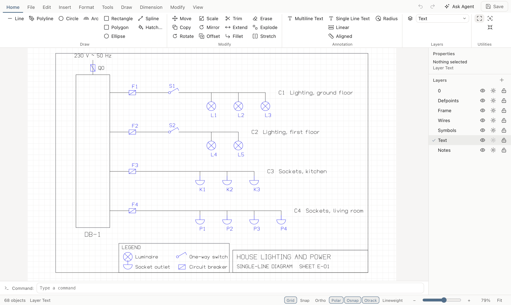
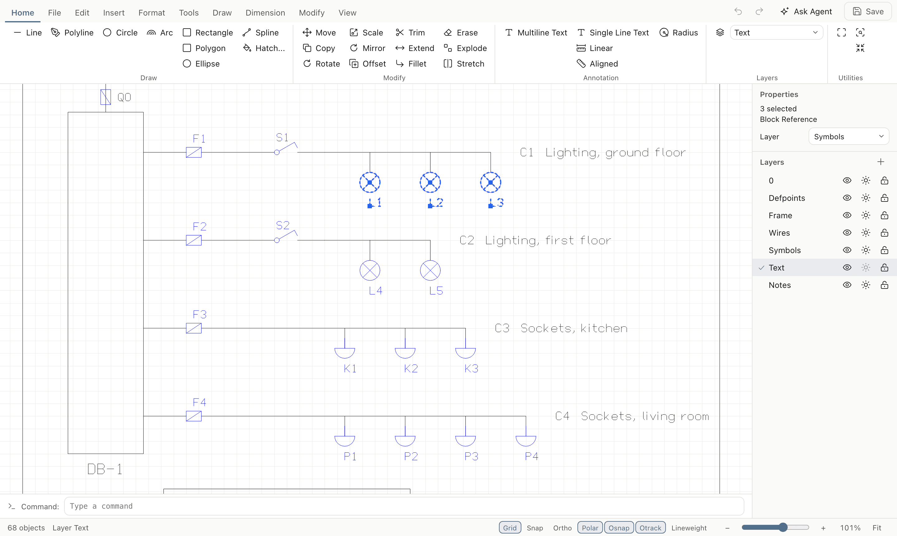
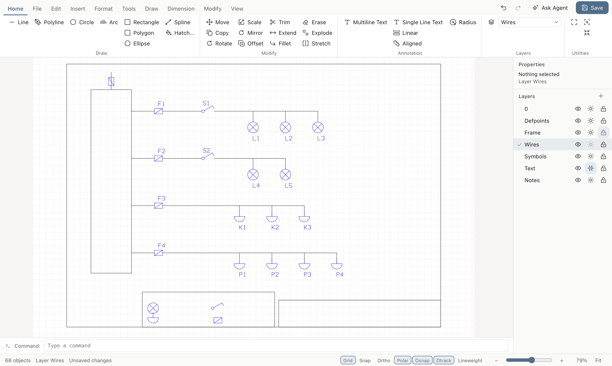
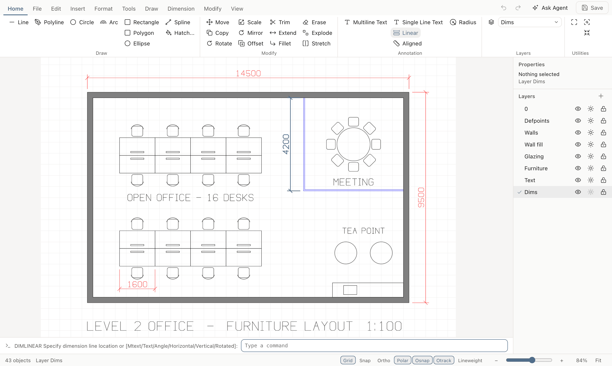
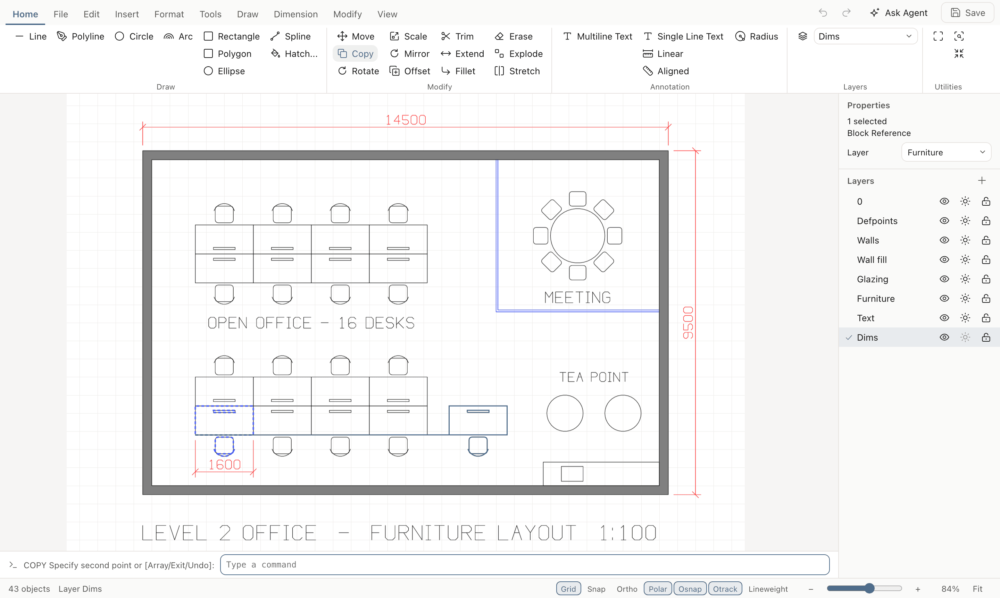
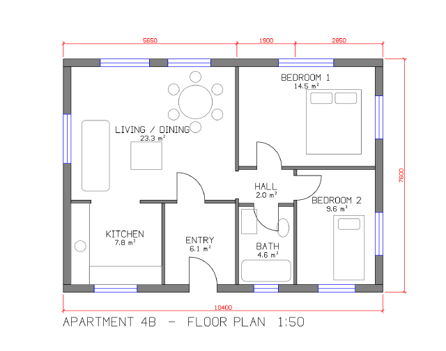
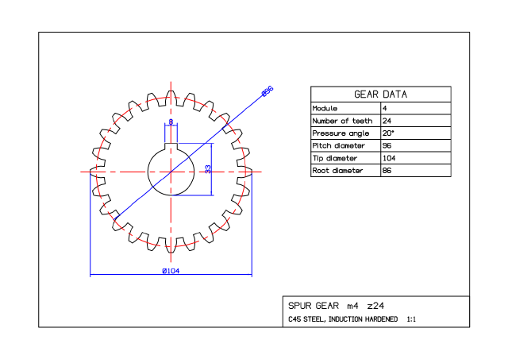
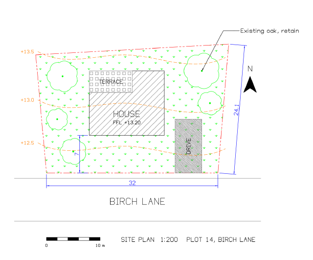
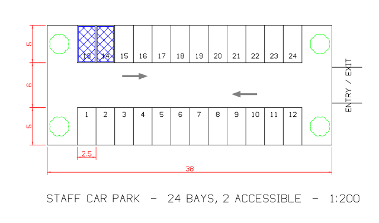

<div align="center">

# Kition CAD

**Kition CAD: a 2D CAD editor for .dxf drawings, for people and AI agents**

Layers · Blocks · Dimensions · Move, copy, rotate and mirror · PDF, SVG and PNG export · Tools for agents

[](LICENSE)
[](https://www.npmjs.com/package/@kition/embed)
[](https://github.com/kitharness/kitharness)
[](bindings/wasm)

[Use it in Kition](https://kition.ai) · [Embed it](#embed-it-in-your-app) · [Give it to your agent](#give-it-to-your-agent) · [Showcase](https://github.com/KitionAI/kition-showcase/tree/main/cad) · [Developer docs](https://developer.kition.ai) · [KHP](https://github.com/kitharness/kitharness)

</div>

A drawing usually lives in one desktop program on one machine. Colleagues mark up a PDF, and you
redraw every comment by hand. An AI assistant can tell you which wall to move, but it cannot open
the `.dxf` and move it.

CAD puts a 2D drafting editor in a browser tab, on plain `.dxf` files. You draw from the ribbon,
with the pointer, or by typing a command and its coordinates. The same engine runs headless for an
AI agent: it reads the drawing, draws and edits with the editor's own commands, and runs the same
check. An agent's write names the revision it read, so a change that rests on something you have
since edited is refused instead of written over yours.



## What it does

### Why CAD

- **Your drawing stays a `.dxf`.** Lines, polylines, circles, arcs, text, layers, blocks and
  dimensions are written to DXF and read back the same; a save-and-reopen test proves each.
- **Draw with the pointer or the keyboard.** Pick a tool on the ribbon and click, or type the
  command and its points. The prompt says what comes next, and the drawing previews the result
  before you click.
- **Layers and blocks keep a sheet in order.** Give each layer its colour, make one current, turn
  one off or freeze it. A symbol drawn once as a block appears wherever it is inserted.
- **Dimensions and edits as a drafter expects.** Linear, aligned and radius dimensions. Move, copy,
  rotate, scale and mirror; polar arrays and hatches.
- **Your agent drafts on the same drawing.** An AI agent reads the layers and blocks, measures,
  draws and edits with the editor's commands, and fixes what the check reports. It can work in a
  draft that you review before anything changes.
- **Share what you drew.** Export the drawing as a PDF, an SVG or a PNG, framed to its extents.

### See it

<table>
<tr>
<td width="50%"><br /><b>Blocks</b>: every luminaire is the one block LAMP with its own ID; select some and Properties says what they are.</td>
<td width="50%"><br /><b>Layers</b>: freeze the Text layer and every label leaves the view; Wires is current and Frame is locked.</td>
</tr>
<tr>
<td width="50%"><br /><b>Dimensions</b>: type <code>dimlinear</code> and two corners at the command line, then place the line with the pointer.</td>
<td width="50%"><br /><b>Copy</b>: select a workstation, give a base point, and the copy follows the pointer until you click.</td>
</tr>
</table>

### Made with CAD

<table>
<tr>
<td width="25%"><a href="https://github.com/KitionAI/kition-showcase/tree/main/cad/two-bedroom-apartment-plan"></a></td>
<td width="25%"><a href="https://github.com/KitionAI/kition-showcase/tree/main/cad/spur-gear-m4-z24"></a></td>
<td width="25%"><a href="https://github.com/KitionAI/kition-showcase/tree/main/cad/garden-house-site-plan"></a></td>
<td width="25%"><a href="https://github.com/KitionAI/kition-showcase/tree/main/cad/office-car-park-layout"></a></td>
</tr>
</table>

Every sample is built with CAD's own commands. [See all of them](https://github.com/KitionAI/kition-showcase/tree/main/cad).

### Formats

| Opens | Creates | Exports |
| --- | --- | --- |
| `.dxf` | `.dxf` | `.pdf`, `.svg`, `.png` |

## Quick start

### Use it in Kition

Open or create a `.dxf` file in Kition and it opens in this editor. Kition's agent works on the same
drawing, with the same commands. [Download Kition](https://github.com/KitionAI/kition/releases/latest).

### Embed it in your app

CAD's editor is a static package you host yourself, mounted into your page with
[`@kition/embed`](https://www.npmjs.com/package/@kition/embed). Download `kition-cad-<version>.tgz`
from the [latest release](https://github.com/KitionAI/kition-cad/releases/latest) and serve its
`cad-ui/` folder on its own origin, with the headers in the
[embed reference](https://github.com/KitionAI/kition-sdk/blob/main/docs/platform/reference/embed.md).
Then:

```ts
import { KitionEmbed } from '@kition/embed'

const editor = await KitionEmbed.mount(document.getElementById('cad')!, {
  kit: { id: 'kit.cad', url: 'https://kits.example.com/cad-ui/' },       // the package you host
  file: { id: 'ground-floor', name: 'Ground floor.dxf' },
  storage: {
    read: async (id) => api.read(id),                                     // { bytes, version }
    write: async (id, bytes, { expectedVersion }) => api.write(id, bytes, expectedVersion), // refuse a stale version
    create: async (name, bytes) => api.create(name, bytes),              // exports (PDF, SVG, PNG) become new files
  },
})
```

Every save carries the version it read, so an edit made elsewhere is never written over. The
[embed guide](https://github.com/KitionAI/kition-sdk/blob/main/docs/sdk/embed.md) adds people and
permissions, co-editing, and an agent working in the open editor.

### Give it to your agent

The engine also runs headless, and `kition`, the Kition SDK's command line, serves it as MCP tools
(`cad_inspect`, `cad_run`, `cad_check`, ...) on a folder of drawings, for any MCP client. Nothing is
compiled: you need neither Rust nor the Kition app. Install `kition`, then connect your agent in the
folder:

```sh
curl -fsSL https://github.com/KitionAI/kition-sdk/releases/latest/download/install.sh | sh
# Claude Code, in the folder:
claude mcp add kition -- ~/.kition/bin/kition mcp --workspace "$PWD"
```

On Windows, install it with
`irm https://github.com/KitionAI/kition-sdk/releases/latest/download/install.ps1 | iex`. With
Node.js 20 or later you can skip the install:
`claude mcp add kition -- npx -y @kition/kits-mcp --workspace "$PWD"`.

`kition` holds no kit. The first time the agent opens a `.dxf` file, through the `kit_inspect` tool
the server offers until CAD is installed, `kition` downloads CAD's headless executable into
`~/.kition/kits` and the cad tools appear. `kition kit install cad` downloads it ahead of time, and
`kition kit upgrade` moves it to the newest version. Claude Desktop, Cursor, Codex and the other
commands are in the SDK's
[agent guide](https://github.com/KitionAI/kition-sdk/blob/main/docs/sdk/agent.md#connect-your-agent)
and [`kition` guide](https://github.com/KitionAI/kition-sdk/blob/main/docs/sdk/cli.md). To run a
build of your own (working on the kit itself), see
[docs/development.md](docs/development.md#run-the-headless-kit-for-an-agent).

A real session on a copy of the circuit diagram above, trimmed:

```text
> cad_inspect {"path":"circuits.dxf"}
Opened `circuits.dxf`: 1307 × 924
{"details":{"blocks":[{"entities":3,"name":"BREAKER",…},{"entities":4,"name":"LAMP",…},{"entities":4,"name":"SOCKET",…},…],
  "currentLayer":"Text","entities":68,"layers":[…,{"entities":27,"name":"Wires",…},{"entities":23,"name":"Symbols",…},…],…},
  "revision":"mdk0",…}

> cad_run {"path":"circuits.dxf","basis":"mdk0","steps":[
    {"command":"move","params":{"pick":[185,135],"delta":[24,0]}},
    {"command":"line","params":{"points":[[172,135],[196,135]],"layer":"Wires"}},
    {"command":"line","params":{"points":[[196,135],[196,127]],"layer":"Wires"}},
    {"command":"insert","params":{"name":"LAMP","at":[196,123],"attribs":{"ID":"L6"},"layer":"Symbols"}},
    {"command":"count","params":{"block":"LAMP"}}]}
Ran 5 commands on `circuits.dxf` (saved): 1307 × 924 Changes: objects 3 created, 1 changed.
{"changes":{"changed":[{"edits":[{"after":208,"before":184,"field":"kind.insert.x"}],…,"type":"Entity"}],
  "created":[…,{…,"description":"Block Reference on layer Symbols","kind":{"attribs":[{…,"tag":"ID","text":{…,"value":"L6",…}}],"block":"LAMP",…}}],…},
  "completed":[{"command":"move","result":{"moved":1}},…,{"command":"insert","result":{"handle":"6217000000002"}},
    {"changed":false,"command":"count","result":{"block":"LAMP","count":7,"message":"Block LAMP: 7 in model space."}}],
  "diagnostics":{"new":[],"resolved":[]},"revision":"mdk1","saved":true}

> cad_check {"path":"circuits.dxf"}
Checked `circuits.dxf`: the kit found nothing wrong.
{"diagnostics":[]}
```

The agent read the diagram's blocks and layers, then added a sixth luminaire, L6, to the first-floor
circuit C2: it moved the circuit's label out of the way, drew the wire on the Wires layer, inserted
the LAMP block with its ID on the Symbols layer, and counted seven LAMP references (six on the
circuits, one in the legend). The check found nothing wrong. The agent's guide is
[agent/guide.md](agent/guide.md).

## Maturity

Version 0.1.0 · KHP 1.0, conformance level `basic`.

| Works today | Partly there | Not yet |
| --- | --- | --- |
| Lines, polylines, circles, arcs, rectangles and text | Typed commands: some prompt options are not there yet | `.dwg` files |
| Layers with colours, the current layer, frozen layers | Object snaps, ortho and polar tracking | External references, a block editor and dynamic blocks |
| Linear, aligned and radius dimensions | Blocks: an agent defines and inserts them; in the editor you select and edit them | Keeping what CAD does not model when it saves another program's `.dxf` |
| Move, copy, rotate, scale, mirror, polar arrays and hatches | Layouts, viewports, page setup and plotting | Auto-save and crash recovery |
| Export to PDF, SVG and PNG; an agent that reads, edits and checks the drawing | Dimension styles, leaders and tables | 3D |

Known gaps: [docs/gaps.md](docs/gaps.md). What's next: [docs/roadmap.md](docs/roadmap.md).

## Build and contribute

Build and test instructions are in [docs/development.md](docs/development.md). Read
[CONTRIBUTING.md](.github/CONTRIBUTING.md) before opening a pull request, and ask questions in
[Discussions](https://github.com/KitionAI/kition/discussions) or on [Discord](https://discord.gg/bFSjRDjVY).

## License

Apache-2.0 ([LICENSE](LICENSE)). Third-party licenses and notices are listed in [NOTICE](NOTICE)
and [docs/attribution.md](docs/attribution.md).

Portions of this kit are derived from a project dual-licensed under MIT or Apache-2.0, used here
under the MIT License and credited in [NOTICE](NOTICE).
